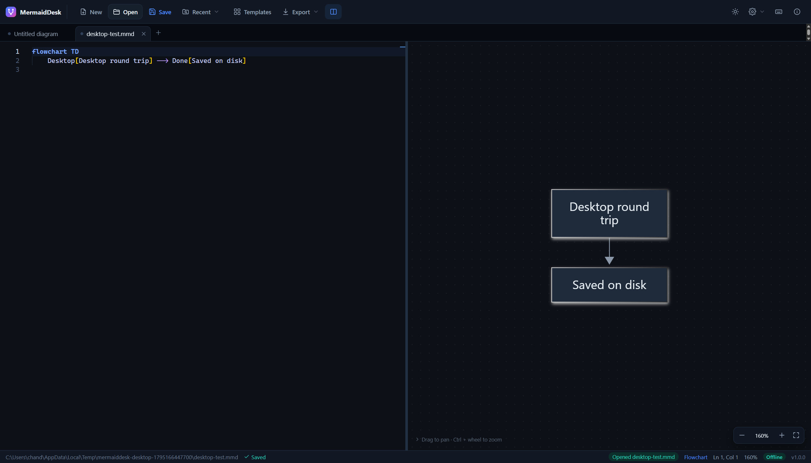

# MermaidDesk

An installable, offline-first desktop editor for [Mermaid](https://mermaid.js.org/)
diagrams. Built with **Tauri 2 + Rust** and **React + TypeScript**, rendered by
Mermaid.js, edited in Monaco.

MermaidDesk writes ordinary `.mmd` / `.mermaid` files to your own disk. There is no
account, no telemetry, no hosted renderer, and no network requirement for any core
feature.



> The screenshot above is captured from the running Windows build by
> `npm run test:desktop`; see `docs/VERIFICATION.md` for recorded results.

## Features

- **Live split-pane editing** — Monaco source editor with Mermaid syntax highlighting,
  bracket matching, snippets, and a debounced live preview.
- **Local files** — open, edit, save, save as, and reopen `.mmd`/`.mermaid` (plus
  `.md`/`.txt`) with native dialogs and atomic writes.
- **Multiple tabs** — independent undo history, dirty indicators, middle-click close,
  drag-to-reorder, and a Save / Discard / Cancel guard for unsaved work.
- **Export & copy** — standalone SVG and 2× PNG, rendered locally (no mermaid.ink),
  either through a native dialog or as a one-click export beside the open diagram. The
  diagram can also go straight to the clipboard as a PNG (opaque or transparent), so it
  pastes into chat, docs and issue trackers without a file in between. SVG export
  includes a theme background by default; a transparent variant is also available and
  keeps the current theme's text colour (use it on a matching background).
- **Zoom & pan** — mouse-wheel zoom at the cursor, drag to pan, fit to window, and
  keyboard zoom controls.
- **Themes** — light, dark, and follow-system, applied to both the UI and diagrams.
- **Templates** — 15 ready-made diagrams across process, structure, time, and data.
- **Diagnostics** — Mermaid syntax errors with line number and "Go to line".
- **Recent files**, **auto-save** (for saved files), **word wrap**, **line numbers**,
  and adjustable font size.
- **Desktop integration** — `.mmd`/`.mermaid` file associations, drag-and-drop,
  single-instance open, native menu, and persisted window state.
- **Keyboard shortcuts** — see below or press `F1` in the app.

## Requirements

| Platform | Requirements |
| --- | --- |
| Windows 10/11 | Node.js 20+ (tested with 24.13), Rust 1.82+ with the MSVC toolchain, Visual Studio Build Tools with "Desktop development with C++", WebView2 runtime (preinstalled on Windows 11) |
| macOS 12+ | Node.js 20+, Rust 1.82+, Xcode command line tools |
| Linux | Node.js 20+, Rust 1.82+, WebKitGTK 4.1 and the usual Tauri system libraries |

The Tauri CLI is installed locally by `npm install` (no global install needed).

## Build the Windows installer

```powershell
npm ci
npm run tauri:build
```

Outputs:

```
src-tauri/target/release/bundle/nsis/MermaidDesk_1.0.0_x64-setup.exe
src-tauri/target/release/bundle/msi/MermaidDesk_1.0.0_x64_en-US.msi
```

The verified installers are also copied to `release/` for convenience
(`MermaidDesk_1.0.0_x64-setup.exe`, `MermaidDesk_1.0.0_x64_en-US.msi`, and the
standalone `MermaidDesk.exe`).

The NSIS installer runs per-user (no administrator prompt) and registers the
`.mmd` / `.mermaid` file associations. The executable inside is
`src-tauri/target/release/mermaid-desk.exe`.

### macOS / Linux

Run the same commands on the target OS. `bundle.targets` is `"all"`, so Tauri produces
`app`/`dmg` on macOS and `deb`/`rpm`/`appimage` on Linux while still producing
`nsis` + `msi` on Windows. The Rust and frontend code is platform neutral, and
`.icns`/PNG icons are included.

## Development

```powershell
npm install
npm run tauri:dev      # desktop app with hot reload
npm run dev            # browser-only UI (in-memory file backend, useful for UI work)
npm run build          # type-check + production frontend bundle
```

## Tests

```powershell
npm run test              # Vitest: 6 files / 49 tests
npm run test:e2e          # Playwright: 22 UI scenarios in Chromium (incl. offline)
cd src-tauri; cargo test  # Rust: 30 unit/integration tests
```

`npm run test:e2e` expects a production bundle: run `npm run build` first. The
Playwright config then serves `dist/` with `vite preview`.

Desktop end-to-end (real Tauri binary, real native dialogs, files on disk):

```powershell
# one-time tooling
cargo install tauri-driver --locked
# download the Edge WebDriver matching your WebView2 runtime into tools/edgedriver/
npm run test:desktop
```

The script is `scripts/desktop-e2e.mjs`; its checks and recorded results are listed in
`docs/VERIFICATION.md`.

## Continuous integration

Two GitHub Actions workflows live in `.github/workflows/`:

| Workflow | Trigger | What it does |
| --- | --- | --- |
| `ci.yml` | push to `main`, pull request, manual | frontend type-check + Vitest + production build; Playwright browser E2E on that bundle; Rust `fmt`/`clippy -D warnings`/tests on **Windows, macOS and Ubuntu** |
| `build.yml` | manual, or pushing a `v*` tag | `tauri-action` bundles on all three platforms. Manual runs upload workflow artifacts; a tag also creates a **draft GitHub release** with the installers attached and notes taken from `CHANGELOG.md` |

The 40-check desktop suite stays local (`npm run test:desktop`): it drives the real
Tauri window with `tauri-driver`, native dialogs and WebView2, which the hosted runners
do not provide. Everything else is covered in CI.

To cut a release:

```bash
node scripts/set-version.mjs 1.0.1   # updates all four version files
# add the "## [1.0.1]" section to CHANGELOG.md, then:
git tag -a v1.0.1 -m "MermaidDesk 1.0.1"
git push origin v1.0.1
```

The draft release's body is extracted from `CHANGELOG.md`, and the workflow refuses
to build if the tag and the app version disagree. The full procedure — including
previews, rollback and publishing — is in [docs/RELEASING.md](docs/RELEASING.md).
Release history lives in [CHANGELOG.md](CHANGELOG.md).

## Keyboard shortcuts

| Action | Shortcut |
| --- | --- |
| New diagram | `Ctrl+N` |
| Open | `Ctrl+O` |
| Save / Save As | `Ctrl+S` / `Ctrl+Shift+S` |
| Close diagram | `Ctrl+W` |
| Next / previous diagram | `Ctrl+Tab` / `Ctrl+Shift+Tab` |
| Zoom in / out / 100% / fit | `Ctrl++` / `Ctrl+-` / `Ctrl+0` / `Ctrl+9` |
| Toggle theme | `Ctrl+Shift+T` |
| Toggle preview | `Ctrl+Shift+D` |
| Export PNG / SVG | `Ctrl+Shift+P` / `Ctrl+Shift+E` |
| Copy diagram as PNG | `Ctrl+Shift+C` |
| Find in editor | `Ctrl+F` |
| Keyboard shortcuts | `F1` |

On macOS, `Ctrl` maps to `⌘`.

## Where data lives

- **Diagrams:** wherever you save them. Nothing is copied elsewhere.
- **Settings:** `%APPDATA%\dev.mermaiddesk.app\settings.json`
  (`~/Library/Application Support/dev.mermaiddesk.app/settings.json` on macOS,
  `~/.config/dev.mermaiddesk.app/settings.json` on Linux), with one
  `settings.backup.json`.
- No SQLite database is used: documents are plain files and the only structured state
  is a small JSON settings object.

## Security

The webview has no filesystem permissions. Rust owns dialogs and file I/O, only
authorises paths the user actually selected, enforces an 8 MiB/UTF-8 limit, and writes
atomically. Mermaid renders with `securityLevel: "strict"`, SVG-text labels, DOMPurify,
and an additional hardening pass; the CSP forbids inline/remote scripts and all remote
connections. See `docs/ARCHITECTURE.md` for the full threat model.

The installer is not code-signed. Windows SmartScreen will show an "unknown publisher"
warning until a certificate is configured (`bundle.windows.certificateThumbprint` and
`signCommand` in Tauri).

## Verification

`docs/VERIFICATION.md` records the executed test suites, desktop checks, installer
inspection, REA evidence for the built binary, and the exact limitations of what was and
was not automated.

## Project layout

```
src/                     React UI, state, rendering, export
  components/            Toolbar, tabs, editor, preview, dialogs
  lib/                   pure logic (tabs, shortcuts, export, sanitisation, platform)
  state/workspace.ts     document/workspace controller
src-tauri/               Rust backend
  src/documents.rs       authorised file access, export, drag-and-drop, argv
  src/settings.rs        atomic settings with backup
  src/menu.rs            native menu
  capabilities/          minimal Tauri permission set
e2e/                     Playwright scenarios
docs/                    assessment, architecture, verification
```

## Licence

MIT (see `LICENSE`). Third-party components are listed in `THIRD_PARTY_NOTICES.md`;
Mermaid.js and Monaco keep their own MIT licences, DOMPurify is dual MPL-2.0/Apache-2.0.


